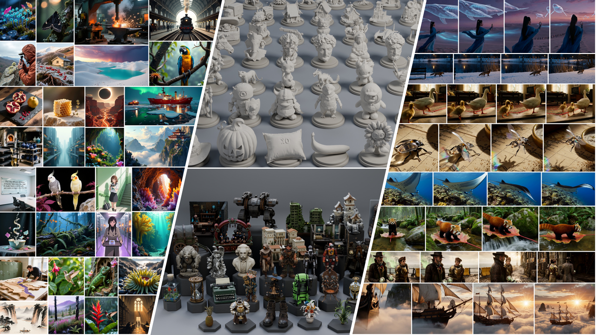

<h1 align="center">
  Simplifying and Improving On-Policy Distillation<br>
  for Few-Step Diffusion
</h1>

<p align="center">
  <a href="https://zjwfufu.github.io/SMD-Page/"></a>
  <a href="https://arxiv.org/abs/2610.18472"></a>
  <a href="https://huggingface.co/zjwfufu/SMD"></a>
  <a href="https://huggingface.co/collections/zjwfufu/smd"></a>
  <a href="https://huggingface.co/collections/zjwfufu/smd-data"></a>
  <a href="README.zh-CN.md"></a>
</p>

<p align="center">
  <a href="https://zjwfufu.github.io/SMD-Page/">
    
  </a>
</p>

*SMD is a simple and scalable method for few-step diffusion distillation across image, video, audio-video and 3D generation.*

## Models

See the [model card](MODEL_CARD.md) for Hugging Face weights, standalone inference and example outputs.

The configurations below use four sampling steps unless noted otherwise. Model names link to their training configs.

| Task | Models |
| --- | --- |
| Text to image | [FLUX.1-dev](smd/configs/experiments/flux1_dev.py), [Qwen-Image](smd/configs/experiments/qwen_image.py), [SD3.5-Medium](smd/configs/experiments/sd35_self.py), [FLUX.2 Klein 4B](smd/configs/experiments/flux2_4b.py), [Lens](smd/configs/experiments/lens.py) |
| Image editing | [Qwen-Image-Edit-2511](smd/configs/experiments/qwen_image_edit.py) |
| Text to video | Wan2.1 [1.3B](smd/configs/experiments/wan13.py) and [14B](smd/configs/experiments/wan14.py), [causal Wan2.1 1.3B](smd/configs/experiments/wan13_causal.py) |
| Audio-video | MiniMax H3 T2VA ([4-step](smd/configs/experiments/h3_t2va_4step.py), [8-step](smd/configs/experiments/h3_t2va_8step.py)) and Ref2VA ([4-step](smd/configs/experiments/h3_ref2va_4step.py), [8-step](smd/configs/experiments/h3_ref2va_8step.py)) |
| Image to 3D | [Hunyuan3D-2.1 Shape](smd/configs/experiments/hunyuan3d_shape.py), TRELLIS.2 [Shape](smd/configs/experiments/trellis2_shape.py) and [Texture](smd/configs/experiments/trellis2_texture.py) |

Additional configs cover SD3.5 reward specialists and [multiple teachers](smd/configs/experiments/sd35_multi.py), plus FLUX.2 9B distillation into [Klein 4B](smd/configs/experiments/flux2_9b_to_4b.py) and [Lens](smd/configs/experiments/flux2_9b_to_lens.py).

## Installation

Requirements:

- Linux x86_64 and Conda.
- NVIDIA GPU with a driver compatible with CUDA 12.6.
- CUDA toolkit and C++ compiler for building FlashAttention from source.

The setup script creates an environment with Python 3.12, PyTorch 2.7.1, CUDA 12.6 wheels and FlashAttention.

Run from the repository root:

```bash
bash environments/setup_conda.sh
conda activate smd
```

For Hunyuan3D mesh previews and TRELLIS.2, install the additional environment:

```bash
bash environments/setup_3d_environment.sh
conda activate smd_3d_extend
```

## Inference

For released weights, follow the standalone examples in the [Hugging Face model collection](https://huggingface.co/collections/zjwfufu/smd).

For your own training checkpoints, [export the student weights](.agents/skills/smd-distill/references/inference.md#weight-export) first, then run the [inference script](infer.py).

For example, with Qwen-Image:

```bash
python tools/download_resources.py --model qwen_image
python infer.py qwen_image --weights /path/to/exported_student \
  --output /path/to/samples --prompt "A red ceramic mug on a wooden table."
```

Pass your exported model directory to `--weights` and choose where to save samples with `--output`. The model directory must contain both student weights and sampling metadata.

See the [inference guide](.agents/skills/smd-distill/references/inference.md#student-inference) for other models and options.

> [!NOTE]
> H3 uses a student LoRA and cached conditions; no fused base checkpoint is needed. Export the adapter with the sampling metadata from the same checkpoint.
>
> Launching with `python` defaults to one GPU; use `--n-gpus` to choose the GPU count. See [H3 export and inference](.agents/skills/smd-distill/references/inference.md#h3-audio-video).

## Training

Choose a configuration from the [training experiments](smd/configs/experiments) and prepare your data using the [data guide](.agents/skills/smd-distill/references/data.md).

For example, train Qwen-Image on two GPUs with a Parquet file containing a `prompt` column:

```bash
export SMD_OUTPUT_ROOT=/path/to/training_runs
torchrun --standalone --nproc_per_node=2 train.py \
  --config smd/configs/experiments/qwen_image.py --download-resources \
  - dataloader_train.dataset_path=/path/to/prompts.parquet \
  log_config.name=qwen-image-my-data
```

Replace the example data file and output directory with your own paths.

The `--download-resources` option downloads required resources automatically. Parameters after the standalone `-` override the selected configuration.

The `SMD_OUTPUT_ROOT` environment variable sets the root directory for checkpoints and previews. W&B logging defaults to offline mode.

See the [training guide](.agents/skills/smd-distill/references/training.md#training-and-resume) for run directories, resume, logging and preview settings.

## Agent skills

To make SMD easier to use and extend, we provide agent skills for [environment setup](.agents/skills/smd-setup/SKILL.md), [training and inference](.agents/skills/smd-distill/SKILL.md), and [model integration](.agents/skills/smd-onboard-model/SKILL.md) in the [skills directory](.agents/skills).

Each skill includes instructions and references that you or your coding assistant can follow.

## Acknowledgments and license

SMD builds on [NVIDIA FastGen](https://github.com/NVlabs/FastGen)'s training infrastructure and uses model implementations from [Hugging Face Diffusers](https://github.com/huggingface/diffusers).

We are grateful to the authors and maintainers of these projects for giving us a foundation to build on.

We thank the authors of [FLUX.1](https://github.com/black-forest-labs/flux), [FLUX.2](https://github.com/black-forest-labs/flux2), [Qwen-Image and Qwen-Image-Edit](https://github.com/QwenLM/Qwen-Image), [Stable Diffusion 3.5](https://huggingface.co/stabilityai/stable-diffusion-3.5-medium), [Wan2.1](https://github.com/Wan-Video/Wan2.1), [MiniMax H3](https://github.com/MiniMax-AI/MiniMax-H3), [Lens](https://github.com/dxqb/Lens), [Hunyuan3D-2.1](https://github.com/Tencent-Hunyuan/Hunyuan3D-2.1) and [TRELLIS.2](https://github.com/microsoft/TRELLIS.2) for sharing their models and code.
These releases made it possible to explore SMD across image, video, audio-video and 3D generation.

We also thank the authors of [Self Forcing](https://github.com/guandeh17/Self-Forcing) and [Causal Forcing](https://github.com/thu-ml/Causal-Forcing) for sharing their code and checkpoints.
Our causal Wan implementation builds on Self Forcing and uses the chunkwise initialization and teacher checkpoints from Causal Forcing.

See [LICENSE](LICENSE), [NOTICE](NOTICE) and [third-party licenses](licenses) for code licensing and attribution.

Model weights, teacher adapters and datasets retain their upstream licenses.

## Citation

```bibtex
@article{smd,
  title   = {Simplifying and Improving On-Policy Distillation for Few-Step Diffusion},
  author  = {Jiawei Zhang and Ziyu Wan and Nanye Ma and Long Zhao and Dong Chen and Hongyu Liu and Qifeng Chen and Dongdong Chen},
  year    = {2026},
  journal = {arXiv preprint arXiv:2610.18472},
}
```
